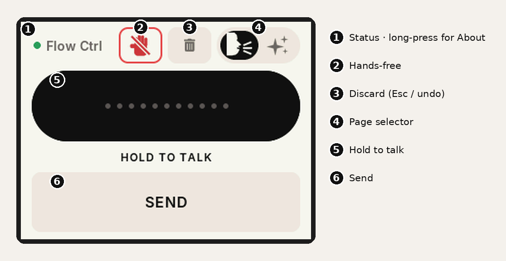
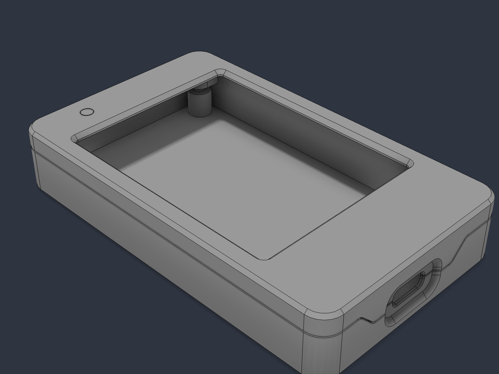

# Flow Ctrl — a push-to-talk button for Wispr Flow on the Cheap Yellow Display

_An open-hardware project from [WOODWERD LLC](https://woodwerd.com), a design group in Austin, Texas._

A dedicated desk button for [Wispr Flow](https://wisprflow.ai) dictation, built on the
ESP32-2432S028R "Cheap Yellow Display" (CYD). The board pairs with your Mac as a **Bluetooth
keyboard** and sends the same keyboard shortcut you already use — so there is nothing to install on
the computer, and nothing about your Wispr setup changes.

- **Hold to talk** — press and hold the big black bar, speak, let go: Wispr transcribes and pastes.
- **Hands-free** — tap the red hand once to lock in, talk for as long as you like, tap the bar to paste it all.
- **Send** — a Return key, so a dictated Claude prompt or chat message goes without touching the keyboard.
- **Discard** — the trash: cancels a running hands-free session (`Esc`), or undoes the last paste (`Cmd+Z`) after a hold.
- **Transforms** — a second page fires Wispr's AI rewrites (Prompt Engineer, plus your own) on selected text.
- Printed split case with only USB-C exposed: the [WOODWERD CYD Case](https://github.com/WOODWERD/cyd-case), shared by all WOODWERD CYD builds (STL/STEP, BOM, build guide).

**New here?** Build the [WOODWERD CYD Case](https://github.com/WOODWERD/cyd-case) (parts, printing, inserts, assembly), then read the [Getting Started guide](docs/GETTING_STARTED.md) (setup and every button, with annotated screens).




> Unofficial. Not affiliated with or endorsed by Wispr. See [THIRD_PARTY_NOTICES.md](THIRD_PARTY_NOTICES.md).

## How it works

Wispr Flow's push-to-talk is a keyboard shortcut. A MacBook's `Fn` key is not a real keycode, so no
external device can send it — but any chord with a normal modifier can be sent by a Bluetooth HID
keyboard, which is what the ESP32 pretends to be. The firmware ships with **Ctrl + Opt + T**; set
Wispr's *Push to talk* shortcut to that (Settings → General → Shortcuts), or rebuild with your own chord.

| On the screen | What the CYD sends | What Wispr does |
|---|---|---|
| **HOLD TO TALK** (press and hold) | chord held down for as long as your finger is | push-to-talk; release = transcribe & paste |
| **Hands-free** (red hand, top row, tap) | chord tapped twice, 120 ms apart | Wispr's "double-tap push-to-talk to lock" gesture → hands-free session |
| **Stop** (tap the bar, or the hand again, while hands-free) | chord tapped once | ends the session, pastes |
| **Hand** (long-press, while hands-free) | nothing | resets the button's state only — use if you stopped Flow from the Mac |
| **SEND** | `Return` | sends what was just pasted — a Claude prompt, a chat message. Tap it once the words have landed |
| **Discard** (trash, top row) — hands-free running | `Esc` | cancels the session, nothing pastes |
| **Discard** — otherwise | `Cmd+Z` (`Ctrl+Z` on Windows) | undoes the last paste: removes what the hold just dictated |
| **Page selector** (lozenge, top row) | nothing | slides between the Dictate and Transform pages |

There is no channel from Wispr back to the button, so the on-screen state is the button's best
guess. If they get out of sync, long-press the red hand.

## Quick start (no toolchain)

1. **Flash.** Easiest: the [Flash page](https://woodwerd.github.io/cyd-flow-ctrl/flash/) in Chrome. Or grab
   `release/flow-ctrl-v0.9.7-cyd2usb-mac.bin` (USB-C / 2-USB board, Mac) —
   or `…-cyd2usb-win.bin` for a Windows PC — or build the `cyd` env for the original micro-USB board. Either:
   - [ESP Web Tools / esptool-js](https://espressif.github.io/esptool-js/) in Chrome or Edge — 460800 baud, address `0x0`, or
   - `pip install esptool` then
     ```
     esptool.py --chip esp32 --port /dev/cu.usbserial-XXXX --baud 460800 write_flash 0x0 flow-ctrl-v0.9.7-cyd2usb-mac.bin
     ```
   **Updating a board that's already paired?** Flash `…-update.bin` at `0x10000` instead. The full image
   at `0x0` wipes the board's Bluetooth pairing and you'd have to pair again.
   (Hold BOOT while plugging in if the port doesn't show up. 921600 baud is unreliable on the CH340.)
2. **Pair.** System Settings → Bluetooth → **"Flow Ctrl"**. The top-left dot turns green and the buttons
   enable. The bond is remembered and reconnects on power-up.
3. **Wispr Flow.** Settings → General → Shortcuts → *Push to talk* → press `Ctrl + Opt + T`.
   Wispr's hands-free lock follows the push-to-talk key automatically, so that's the only setting.
4. Talk.

**Windows** works the same way: pair in Settings → Bluetooth, and set Wispr Flow's push-to-talk to
**Ctrl + Alt + T** (the board sends the same keys; Windows just calls Opt "Alt"). Use the `-win`
image so the screen says Alt/Ctrl and *Select all* sends `Ctrl+A` rather than `Win+A`. Note the board
bonds to whichever computer pairs it; to move it between a Mac and a PC, forget it on the one you're
leaving.

**Pairing gone weird?** About page → **Forget pairing** (tap twice), then remove Flow Ctrl on the computer and add it again. The board also does this by itself if the computer's key stops matching.

**Which firmware is on it?** The version and chord show for four seconds at power-up; long-press the **Flow Ctrl**
title (top-left) any time for the About page — version, build, chord, Bluetooth address.

If the chords do nothing in Terminal or a password field, that's macOS *Secure Keyboard Entry* — see
Wispr's help article on it. It affects every keyboard, not just this one.

## Page 2 — Transforms

The lozenge selector in the top row (talking head = Dictate, sparkles = Transform; a black knob slides to the active one) flips to a second page that fires Wispr's *Transforms* — AI rewrites
of whatever text is selected on the Mac. Buttons come from the `XFORMS` table at the top of `main.cpp`;
add a row, rebuild, and it appears in the next empty slot (four slots per page).

| Button | Sends | Set up in Wispr → Settings → Transforms |
|---|---|---|
| **PROMPT ENGINEER** | `Opt+2` | built in |
| **DRAWING NOTE** | `Opt+3` | custom: *Rewrite as terse construction-drawing callouts: material, size, finish, location. Fragments, not sentences. Uppercase. Keep dimensions exact.* |
| **CLIENT EMAIL** | `Opt+4` | custom: *Rewrite as a warm, concise client email from a residential designer. Plain language, no jargon. Keep every decision, dimension, price and date exact. End with one clear next step.* |
| **Select all** | `Cmd+A` | — |
| **View diff** | `Opt+O` | built in |

The Claude flow: dictate into the prompt box → **Select all** → **PROMPT ENGINEER** → back to **DICTATE** → **SEND**.
The top row — hands-free hand, trash and the page selector — is shared by both pages, so you can see a hands-free session running (the hand and the dot turn red) and stop or discard it from either page. Switching is a tap, not a swipe, so a heavy finger on HOLD TO TALK can never turn into a page change.

## Docs

- [Case & parts](https://github.com/WOODWERD/cyd-case) — the WOODWERD CYD Case: bill of materials, which board to buy, printing, heat-set inserts, screws, assembly
- [Flash it](docs/flash/index.md) — one-click install from Chrome (on the docs site), or esptool
- [Getting Started](docs/GETTING_STARTED.md) — setup, every button and its intent, the three flows, troubleshooting
- [Firmware & code](docs/firmware.md) — build flags, code map, how to drive another app with it
- [Bench test](docs/TESTING.md) — the checklist every release has to pass
- [Changelog](CHANGELOG.md)
- [Publishing checklist](docs/PUBLISHING.md) — how this reaches the CYD project list and the docs site

## Case

Flow Ctrl uses housing v2 of the [WOODWERD CYD Case](https://github.com/WOODWERD/cyd-case): three parts, no supports, PETG, four
M3 × 14 countersunk screws and four M3 × 4 mm heat-set inserts. Only the USB-C port is exposed; a clear
light pipe carries the ambient-light sensor through the lid. The case lives in its own repository so
every WOODWERD CYD firmware (Flow Ctrl, Media Ctrl, …) shares one set of files.

## License

Firmware and documentation: © 2026 WOODWERD LLC, released under MIT (see `LICENSE`). Third-party components and fonts retain their
own licences — listed in `THIRD_PARTY_NOTICES.md`.
