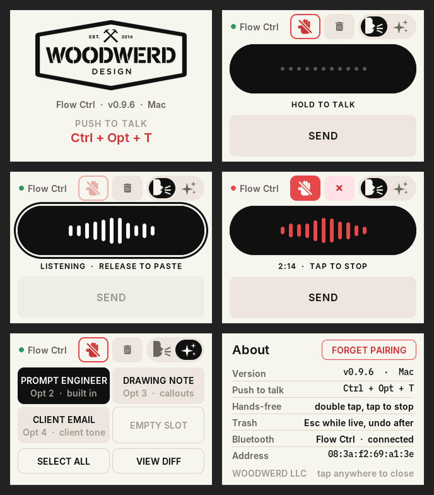

# Firmware & code

## Build it yourself

```
pip install platformio
pio run -e cyd2usb-mac      # USB-C / 2-USB board (ST7789, BGR), Mac host
pio run -e cyd2usb-win      # same board, Windows host (Alt/Ctrl labels, Ctrl+A)
pio run -e cyd              # original micro-USB board (ILI9341)
tools/merge.sh cyd2usb-mac  # full 0x0 image, -update.bin (0x10000) and the web-flasher pieces; version from include/version.h
```

Build flags (add to `build_flags` or `-D` on the command line):

| Flag | Default | Meaning |
|---|---|---|
| `PTT_MODS` | `(MOD_CTRL\|MOD_OPT)` | modifier bits of your Wispr push-to-talk chord (`MOD_CTRL`, `MOD_SHIFT`, `MOD_OPT`, `MOD_CMD`) |
| `PTT_KEY` | `KEY_T` | the key in the chord (`KEY_T`, `KEY_SPACE`, or any HID usage code) |
| `PTT_LABEL` | `"Ctrl + Opt + T"` | what the About page shows for the chord — set it if you change the chord |
| `HOST_WIN` | unset | Windows host: Alt/Ctrl names on screen, `Ctrl+A` for Select all (the `cyd2usb-win` env sets it; `cyd2usb-mac` is the default) |
| `PANEL_ROTATION` | `1` | `3` flips the landscape image 180° (USB on the other side) |
| `BLE_NAME` | `"Flow Ctrl"` | name shown in Bluetooth settings |
| `DIM_AFTER_MS` | `0` | `0` = always full brightness (the board is USB-powered). Set e.g. `45000` to dim after idle; it never turns off |
| `LED_QUIET` | unset | define to silence the RGB LED |
| `TOUCH_DEBUG` | unset | print raw touch coordinates on serial |

Stack: PlatformIO · espressif32 7.1.3 (Arduino) · LVGL 9.5 · TFT_eSPI · XPT2046_Touchscreen ·
NimBLE-Arduino 2.x. ~103 KB RAM, ~890 KB flash. Compiles clean with no PSRAM.

## The screen

Landscape 320 × 240, a light "paper" theme taken from Wispr Flow: warm off-white, black type, one
red accent kept for live or destructive states (`-DTHEME_DARK` restores the old dark colours).
HOLD TO TALK is a 296 × 78 px black bar styled after Wispr's Flow bar, with eleven waveform bars
inside: dots at rest, white while held (plus a ring around the bar), red during hands-free. Under it a
12 px status line; under that SEND, full width at 66 px. The top row carries the hands-free hand, the
trash and the page selector. During hands-free the hand turns solid red and a tap anywhere on the bar
stops the session — the big target, so stopping never takes aim. The RGB LED follows the same state.
The backlight stays at full brightness — the board is USB-powered, so there is nothing to save and
never a "wake-up" tap.

Colours, radii and fonts are tokens in `src/theme.h`. `tools/mock.py` renders every state with PIL so
you can retune without flashing; `tools/make_guide.py` builds the annotated screens in `docs/`.



## Code map

```
platformio.ini      envs: cyd (ILI9341) / cyd2usb-mac (ST7789, BGR) / cyd2usb-win (+HOST_WIN). Pins from the CYD repo's PINS.md
include/version.h   FW_VERSION — the one place the version lives (banner, splash, About page, merge.sh)
src/main.cpp        UI (LVGL), touch, state machine, backlight, LED
src/ble_kbd.*       minimal NimBLE HID keyboard: boot-keyboard report map, press / releaseAll / tap
src/theme.h         colour, radius and font tokens
src/assets/         Inter SemiBold 12/14/16/20 + IBM Plex Mono 14 as LVGL fonts (OFL, licences alongside); ic_*.c icons (head, sparkles, hand)
include/lv_conf.h   LVGL 9.5 configuration
tools/merge.sh      full 0x0 image + app-only update image + bootloader/partitions/boot_app0 pieces
tools/make_icons.py PIL-drawn icons → LVGL A8 arrays in src/assets (needs LVGL's LVGLImage.py)
tools/sim/run.sh    renders the real firmware on a desktop (LVGL + stubs, no board) and rebuilds the docs
                    images: guide-*.png and screen-states.png. Use this after any screen change.
tools/mock.py       older PIL mock of the v0.9.5 screens (superseded by tools/sim)
tools/make_guide.py older annotated screens for v0.9.5 (superseded by tools/sim)
case/               STL + STEP for base, lid, light pipe; print/assembly notes; fastener spec
release/            prebuilt merged image
```

### Notes for anyone adapting it
- The display is driven with a plain TFT_eSPI flush callback and `setRotation(1)`, not LVGL's
  `lv_tft_espi` helper, so landscape needs no software rotation.
- Touch calibration is self-adjusting: the raw min/max grow as you use it, so the corners get
  accurate after a few presses. `TOUCH_DEBUG` shows the raw numbers if a board is far off.
- The HID layer sends modifiers in one report and the key in the next, 12 ms later, like a physical
  keyboard does — some apps ignore a chord that arrives in a single report.
- **Bluetooth link tuning (v0.9.5).** macOS opens a HID link with a 720 ms supervision timeout, then
  moves a bonded keyboard to *interval 15 ms, latency 22*. On the ESP32 that latency is the problem:
  the board is allowed to sleep through 22 connection events, occasionally misses a channel-map
  instant, and the Mac drops the link with `0x228` — which looked like the button "going back into
  pairing mode" every minute or two. `ble_kbd.cpp` therefore waits until the link is encrypted, then
  asks for **latency 0, 6 s timeout** (`BleKbd::tick()` from `loop()`), and asks again if the Mac
  re-applies latency (three tries per connection, so it can never ping-pong). The board is
  USB-powered, so listening on every event costs nothing. The serial log at 115200 prints every
  parameter change and decodes disconnect reasons if you need to see it on your own Mac.
- **Version on the glass.** A four-second logo splash at boot (painted to the panel before LVGL starts, then faded out) and an About page on long-press of the title
  (`show_about()` in `main.cpp`, drawn on LVGL's top layer). It is a long press on a label, not a
  button, so it can't be triggered by a heavy hand on HOLD TO TALK. No swipes anywhere, on purpose.
- **Bond mismatch heals itself.** If the link dies at the encryption step twice in a row (reasons
  0x205/0x206/0x23D — the computer's key no longer matches ours, typically after a flash with
  erase), `ble_kbd.cpp` deletes its bonds and the status line asks the user to remove and re-add the
  device. The About page's **Forget pairing** does the same on demand. The Flash page no longer
  offers to erase, so an ordinary reflash keeps the bond.
- **The trash is contextual.** `discard()` sends `Esc` while a hands-free session is open (Wispr
  cancels it) and `Cmd+Z` / `Ctrl+Z` otherwise (undoes the last paste). It never fires under a held
  chord, because releasing the chord early would paste before the Esc arrived.
- Any other app with a keyboard shortcut (Superwhisper, MacWhisper, a meeting mute key, a macro)
  can be driven the same way: change `PTT_MODS` / `PTT_KEY`.

